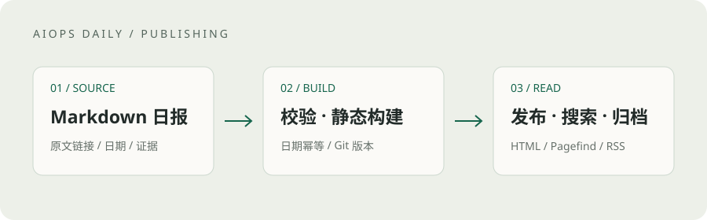

**AIOps Daily** 是一份中文技术选读，关注 AIOps 应用、Agent 开发与治理，以及智能运维工程实践。

相比追逐更多条目，我们更希望留下值得回看的变化：它解决了什么问题、目前处于什么阶段、哪些结论还需要验证。

## 如何阅读

- **原文优先**：摘要保留公开原文链接，厂商案例的效果数据注明归属，不承诺可直接复现。
- **时间透明**：发布日期、首次发现日期分别记录。来源只有日期时，明确标注精度限制。
- **历史补充单列**：历史文章不会为了凑数被标成「24 小时新文」。
- **分析不等于事实**：项目启发与行动建议是阅读分析，不是厂商已交付的能力。

## 从 Markdown 到可搜索的归档

原始日报保存在 `content/daily/YYYY-MM-DD.md`。导入器按日期生成固定地址，同一天重复导入不会产生第二篇日报。修改通过 Git 留下记录，网站则在构建时生成静态 HTML、专题、时间归档、RSS 与 Pagefind 中文全文索引。

这条发布链只消费已有日报，**不会另外启动一套采集或发送任务**。

## 开放技术，轻量阅读

本站基于 [AstroPaper](https://github.com/satnaing/astro-paper)，由 [Astro](https://astro.build/) 静态构建，全文搜索使用 [Pagefind](https://pagefind.app/)。支持手机阅读、明暗主题、键盘导航、Markdown 图片与原文链接。

日报中的摘要不替代原文。更正时优先修订原始 Markdown，并重新构建。
