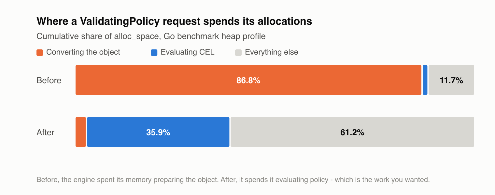
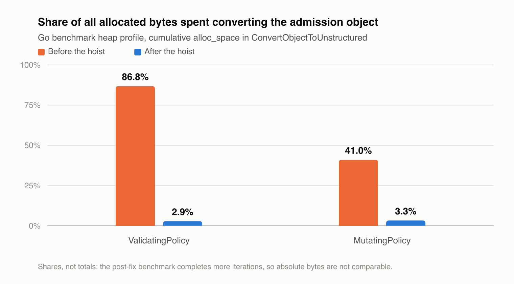
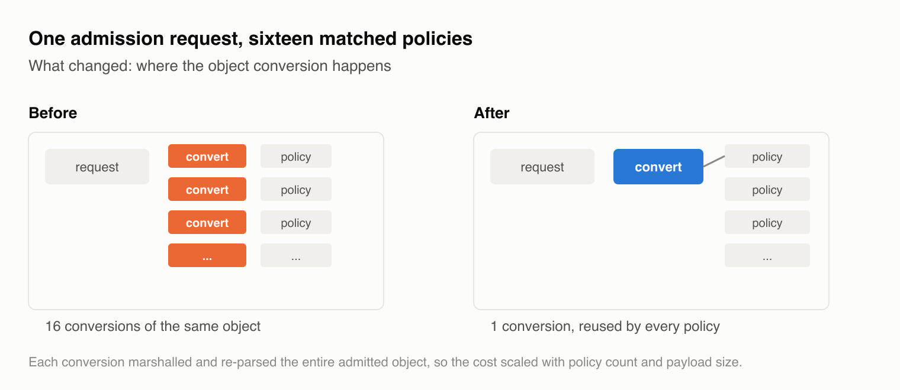
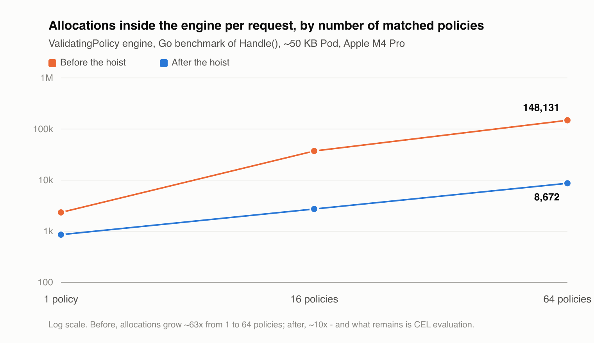
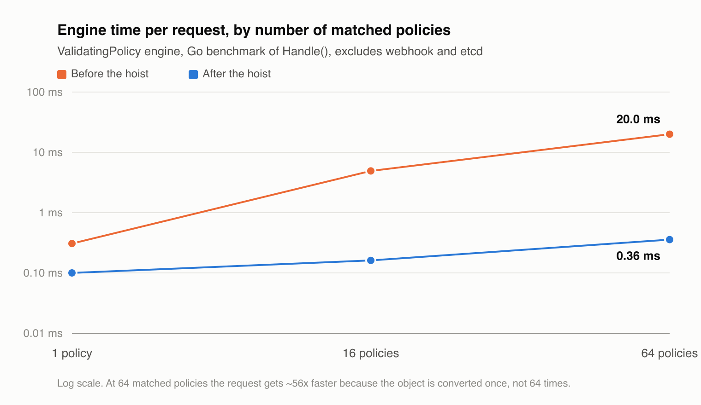
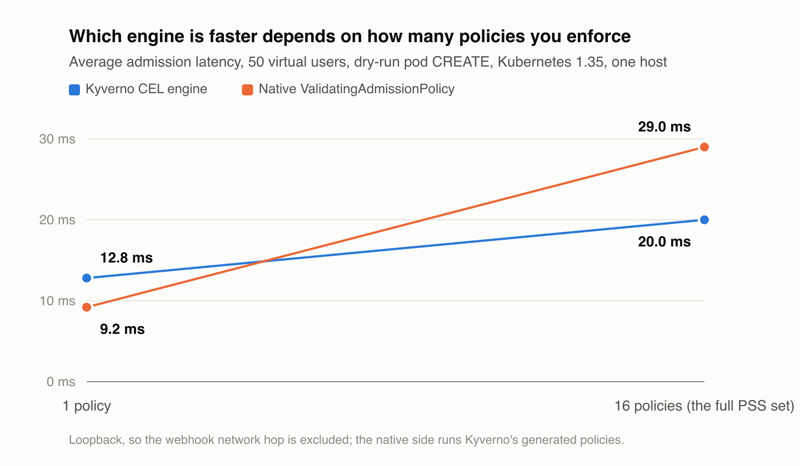
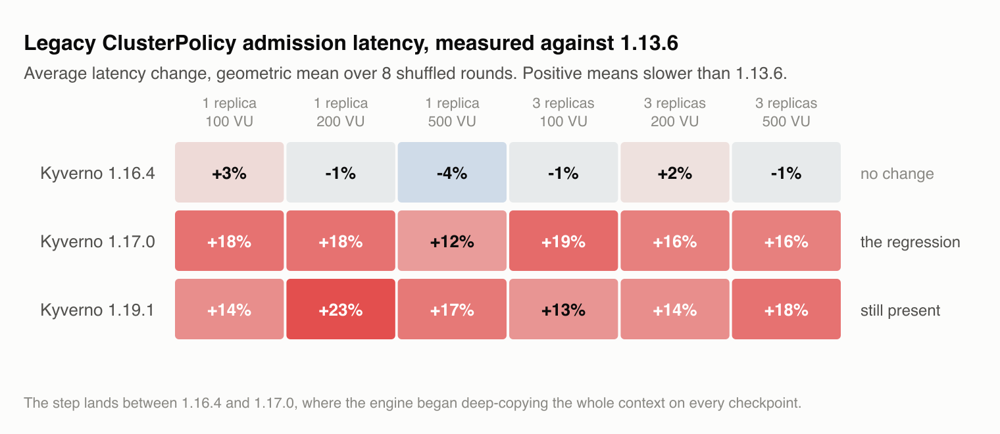

作者：Raunak Madan（CNCF 转载页注明：Nirmata 软件工程实习生）  
原文发布日期：2026-10-19；CNCF 转载日期：2026-11-18。  
[查看原文](https://kyverno.io/blog/2026/10/19/kyverno-cel-admission-cost/)  
原始源文件：https://github.com/kyverno/website/blob/0d3cbabe68ac969d318d4080550002b37b24a7f8/src/content/blog/kyverno-cel-admission-cost/index.md  
许可：[Apache License 2.0 完整许可](/aiops-daily-blog/licenses/kyverno-website-apache-2.0.txt)。原文及随文图表来自 Kyverno 网站源仓库；保留原作者归属。  
**翻译修改声明：本文为 dot 于 2026-11-19 制作的完整中文翻译，不是摘要。正文、标题及图注译为中文；标识符、数字、表格和参考链接保留。图表保留英文原图，不代表原作者认可本译文。**

原文分类：General、Performance。原文导语：对 CEL 准入路径的性能剖析发现，Kyverno 引擎所分配内存的 86% 用于准备对象，而非求值策略。下文解释原因、所做的修改，以及现在的测量结果。

---

Kyverno 基于 CEL（Common Expression Language，通用表达式语言）的引擎用于对策略表达式求值。因此，在对准入路径进行性能剖析时，我们原本预计大部分开销会花在 CEL 求值上。

但事实并非如此。**引擎所分配内存的大约 86% 用于准备待求值的对象，几乎没有花在策略求值上。**

我们之所以展开调查，是因为一项公开基准测试显示，Kyverno 落后于其他方案。这些基准测的是旧版 `ClusterPolicy` JMESPath 引擎，当时它确实出现了性能回退。对此，通常的回答是建议大家转用较新的 CEL 引擎。这个回答没有错，但并不完整：我们还没有检查 CEL 引擎自身究竟把时间花在了什么地方。

本文讨论这部分性能开销从何而来、为何会随着部署的策略数量增加而增长，以及消除它带来了什么变化。修复随 Kyverno 1.19.2 交付。

引用本文任何数字前，请先阅读“局限性”一节。也请像往常一样，在自己的环境中运行测试，获得符合实际情况的准确结果。

## 性能剖析揭示了什么

Kyverno 的 CEL 引擎使用 CEL 的 *activation* 对策略求值：这是一组可供策略表达式引用的变量。其中一个变量是 `request`，即 API server 发来的 `AdmissionRequest`，它已被转换为 CEL 能理解的非结构化 map 形式。

下面是 `ValidatingPolicy` 引擎处理准入请求时，修改前后的堆内存剖析，按占总分配字节数的比例展示：

修改前，`ConvertObjectToUnstructured` 占引擎全部内存分配的 86.8%，CEL 求值本身几乎可以忽略不计。修改后，对象转换降至 2.9%，最大的单个调用栈帧变成了 `evaluateWithData`，也就是真正运行策略表达式的代码。

`MutatingPolicy` 引擎也有同样的情况：它承担的同类开销较小，但仍然相当可观。

阅读这些剖析图时需要注意：修复后的基准运行得更快，在相同时间内完成了更多次迭代，因此两份剖析的绝对总量不同。应比较占比，而不是原始字节数。每个请求的数据见后面的基准表格。

## 原因：同一个对象，每条策略都转换一次

API server 以原始 JSON 字节的形式发送待准入对象。CEL 无法读取字节，因此 Kyverno 必须先将它们解析为 CEL 能理解的 map 形式，才能基于对象进行任何求值。

此前，这个转换发生在遍历匹配策略的循环内部，而不是循环之前。使用 Pod Security Standards 策略集时，一次典型的 Pod 创建大约会匹配 16 条策略。因此，Kyverno 会把同一个 Pod 解析 16 次，每次的输入和输出都一样。这部分开销随着策略数量及待准入对象的大小增长：本应是 O(1)，却成了 O(policies)。

策略之间，对象并没有变化。从来就没有必要转换多次。

## 修复：每个请求只转换一次

这项修改将转换移出了逐策略循环。Kyverno 在循环开始之前构建一次 CEL 的 `request` 值，所有匹配策略都复用它。

要做到这一点，同时不改变策略所看到的内容，需要仔细处理。转换中代价高昂的部分是待准入对象本身，因此 Kyverno 会先复制请求，并暂时将其中的对象置空后再转换，这样遍历的就只剩下开销很低的字段，随后再将对象拼接回去。结果仍然由同一套转换代码生成，所以输出与策略此前看到的一致，而不是重新实现一套逻辑，再让人手工维持同步。

### 保持策略行为完全一致

第一次尝试为所有 CEL 引擎使用同一个共享构建器。测试发现，这悄悄改变了策略的行为，因为各个引擎最初就没有就 `request.object` 的含义达成一致。

验证策略和生成策略看到的对象与 API server 发送的完全一样；变更策略看到的是一个规范化后的版本。两者对于空对象在 CEL 中应呈现为何种形式也存在差异。这对 DELETE 等操作很重要，因为这类操作的一侧对象是缺失的。

将它们统一，会改变用户已经部署的表达式的结果。这是一个值得讨论的话题，但不应由性能修复擅自引入。因此，每个引擎都保留了原有的行为约定，只在底层共享同一个快速实现。

等价性测试将这一点固定下来：以原代码为参照，对所有请求类型逐字段比较新旧代码的输出，任何偏差都会使构建失败。

## 有哪些变化

基准测试使用一个约 50 KB 的 Pod，改变匹配策略数量，直接调用引擎。它只测量引擎本身的耗时，包括构建 `request` 值、匹配和 CEL 求值，不包含 webhook 往返、API server 或 etcd。因此，这些数字并不是端到端准入延迟。

| 匹配策略数 | 修改前分配次数 | 修改后分配次数 | 修改前引擎耗时 | 修改后引擎耗时 |
| --- | --- | --- | --- | --- |
| 1 | 2,327 | 854 | 0.31 ms | 0.10 ms |
| 16 | 37,055 | 2,718 | 4.91 ms | 0.16 ms |
| 64 | 148,131 | 8,672 | 20.01 ms | 0.36 ms |

`MutatingPolicy` 引擎也沿着同样的曲线改善：64 条策略时，分配次数从 258,943 降至 52,689，耗时从 10.59 ms 降至 2.97 ms。

重点是曲线的斜率，而不是醒目的提升倍数。修改前，策略从 1 条增加到 64 条，分配次数增至原来的约 63 倍；修改后，增至原来的约 10 倍。剩余的增长来自 CEL 求值，这正是部署策略所希望完成的工作。现在，对象准备在每个请求中的开销是常量，不再与运行的策略数量成正比。

实际意义是：过去，给 Kyverno 部署增加策略，除了所要求的求值之外，还会带来一项隐蔽的逐策略序列化开销。现在不会了。

## 镜像验证也一样

镜像验证引擎也存在同样的模式，而且还保留着自己的一份转换代码副本，因此也接受了同样的修复。这里的收益是内存而非速度：镜像验证的大部分时间用于经由网络获取签名和证明材料，这部分没有改变。

## 与原生准入策略相比如何

逐策略的额外开销消失后，值得问一问：与 API server 自身的 `ValidatingAdmissionPolicy` 相比，Kyverno 的 CEL 引擎究竟处于什么水平？

在一个集群上，让两个引擎运行相同的 16 条 Pod Security Standards 策略，答案取决于实际执行多少条策略：

只有一条策略时，原生方案领先：约 9.2 ms，Kyverno 则为 12.8 ms。运行完整的 16 条策略集时，Kyverno 领先：约 20 ms，原生方案则为 29 ms。

这些数字是在 Kyverno 1.19.0 上测得的，早于本文介绍的修改。图中 Kyverno 一侧的结果现在应当更好；我们尚未重新运行这项对比。

两个引擎承担开销的方式不同。原生方案在 API server 上分别分发每一条策略，因此开销随执行的策略数量增长。Kyverno 每个请求只承担一次经 webhook 接收对象的开销，随后无论有多少条策略求值，都共享这项开销。只有一两条策略时，原生方案领先；当策略数量达到实际使用的规模时，Kyverno 就能与其持平，甚至领先。

这种描述只有在本次修复之后才成立。此前，Kyverno 的开销并不是每请求固定的，而是逐策略产生的，这也正是其曲线呈现此前形状的原因。

CPU 方面的差距则更明显。在相同负载下，Kyverno 引擎使用约 3.2 个核心，而原生方案的 API server 使用 8.2 个核心。API server 性能剖析中令人意外的是：67% 的 CPU 花在策略分发机制上，而真正的 CEL 字节码执行仅占约 5.5%。开销在于分发 16 条策略，并为每条策略构建输入，而不是对它们求值。并且，这些负载落在控制平面上，无法像扩展 Kyverno Deployment 那样进行横向扩展。

这两组数据都来自单主机环境，webhook 跳转走回环网络，实际上几乎没有开销。在真实的多节点集群中，这一跳会给每个 Kyverno 请求增加实际的网络延迟，缩小延迟差距，且在策略数量较少时影响最大。CPU 方面的发现不依赖网络拓扑。

## 简谈旧版引擎

促使我们开展这项工作的基准测试，测的是较旧的非 CEL 引擎 `ClusterPolicy`，因此也值得交代一下它的情况。

我们在四个版本上复现了性能回退，每个版本都使用全新集群，进行八轮测试，并打乱运行顺序，避免系统性地偏向某个版本；全部结果都与 1.13.6 比较。

性能回退是真实存在的，幅度随负载不同介于 12% 到 23% 之间，出现在 1.16.4 和 1.17.0 之间。正是在这时，为修复一条规则的数据可能泄漏到下一条规则的另一个缺陷，引擎开始在每个检查点复制整个求值上下文。

本次修复保留了这项保证，但不再预先承担全部复制开销：它先获取浅快照，只有在确实发生写入时才复制相应的值。基准结果大致恢复到性能回退前的水平，规则隔离仍然成立，并由一个在旧代码上会失败的测试固定下来。

这项修改与 CEL 优化一起在 1.19.2 中交付，而且只在这个版本中交付。旧版引擎正在退出，因此精力应投入替代它的新引擎。

## 这次没有解决什么

- 为保留 `request.object` 一直暴露的原始、未经规范化的解析结果，引擎每个请求仍要承担一次待准入对象的 JSON 往返转换。若基于类型化对象或开销更低的表示求值，甚至可以消除这一点，但那会改变策略所看到的内容，因此需要独立设计。
- 变更策略在策略之间传递完整对象，而不是传递补丁差异。仅使用补丁的模型需要规模大得多的重新设计，目前尚未实现。
- 这些修改都没有解决单副本持续负载下的尾延迟，我们此后也尚未重新测量。如果你曾看到 Kyverno 在高负载下的 p95 在不同轮次间大幅波动，那是另一个问题，目前仍未解决。

## 局限性

- **单机。** 这里所有实验复现的是配置之间的*关系*，而不是你会在一台 32 核服务器上看到的绝对数字。
- **大部分结果来自 Go 基准测试。** 分配次数与耗时来自驱动真实引擎循环的基准测试，性能剖析也来自这些基准运行。它们清晰地隔离了引擎，但不包含网络、webhook 边界上的序列化和 etcd。
- **引擎对比使用回环网络**，因此排除了 webhook 的网络跳转；同时使用 dry-run，因此排除了 etcd 写入。
- **原生方案运行的是 Kyverno 生成的策略**，这是忠实的同策略对比，而不是一套手工调优的原生策略集。
- 这些运行中关闭了其他控制器，只有准入控制器处于活动状态。

## 复现实验

测试框架位于 Kyverno 仓库的 `docs/perf-testing/` 下，包括版本梯度、固定的 Pod Security Standards 策略集、k6 脚本和集群配置。引擎基准与被测代码放在一起，位于 `pkg/cel/policies/vpol/engine` 和 `pkg/engine/context`。

如果你对 Kyverno 进行基准测试，得到不满意的结果，请把它发布出来，同时附上方法、注意事项以及每轮测试的数字。

## 结语

Kyverno 的使命是成为 Kubernetes 及更广泛场景中最好的策略引擎。准入控制是 Kubernetes 集群中的关键过程，控制器缓慢或配置不当会影响集群运行。感谢社区的帮助，我们修复了性能问题并增加了更多测试。在未来版本中，我们将着眼于改善并发能力并进一步优化。

感谢 [Mustafa Erdinç](https://merdincz.com/en/comparing-kubernetes-policy-engines/)，他对不同 Kubernetes 策略引擎的比较促成了这项工作。

## 参考资料

- [#17572](https://github.com/kyverno/kyverno/pull/17572)：每个准入请求只构建一次 request activation。
- [#17585](https://github.com/kyverno/kyverno/pull/17585)：将镜像验证引擎中的 request map 构建移出循环。
- [#17565](https://github.com/kyverno/kyverno/pull/17565)：降低引擎上下文检查点的复制开销。
